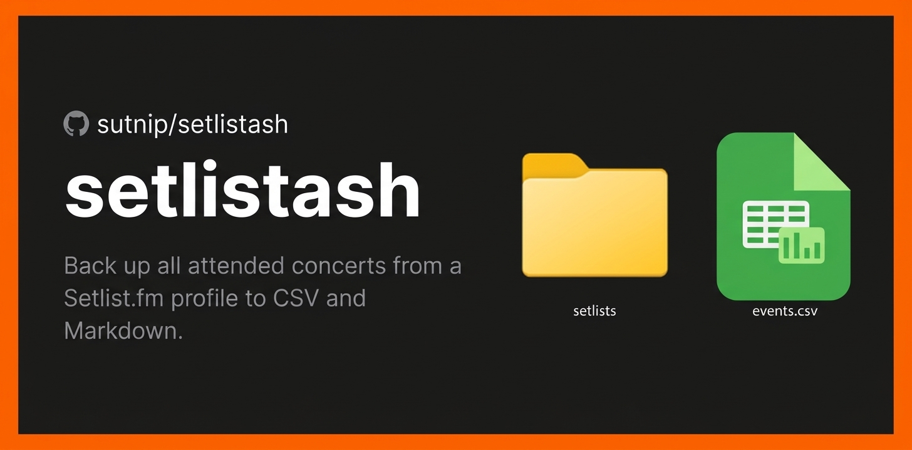

# Setlistash

<p align="center">
  <a href="https://pypi.org/project/setlistash/"></a>
  
  
  <a href="LICENSE"></a>
</p>

<p align="center">
  
</p>

`setlistash` is a cross-platform Python CLI tool that creates complete, non-destructive local backups of every attended concert saved in a [Setlist.fm](https://www.setlist.fm/) profile.

Each backup run produces a fresh timestamped folder containing an Excel-compatible `events.csv` index, one formatted Markdown file with YAML frontmatter per concert, and an optional raw JSON archive.

## Features

- **Full pagination & API compliance:** Fetches every attended concert from Setlist.fm REST API v1.0 with built-in rate limiting (0.6s minimum spacing) and exponential backoff retry on HTTP 429.
- **Zero overwrites:** Every run writes to a new timestamped directory (`setlistash_backup_<user>_<YYYY-MM-DD_HH-MM-SS>`) with automatic progressive suffixes on collisions.
- **Portable & system config:** Stores credentials securely in your OS configuration directory via `platformdirs`, or locally in `./config.json` for portable workflows.
- **Cross-platform filenames:** Sanitizes Windows, macOS, and Linux reserved characters, enforces a 120-character filename cap, and deduplicates same-day collisions using `setlist_id`.
- **Rich Markdown + CSV output:** Exports `utf-8-sig` CSV ordered newest-to-oldest alongside Markdown setlists supporting multiple sets, encores, covers, guest artists, tape tracks, and song notes.

## Requirements

- Python 3.10 or newer
- A free Setlist.fm API key

## Obtaining a Setlist.fm API Key

1. Sign in to your Setlist.fm account.
2. Open the API key settings page: [https://www.setlist.fm/settings/api](https://www.setlist.fm/settings/api).
3. Request a non-commercial API key for personal backup use.
4. Copy the generated key and save it with `setlistash config` (never commit your key to version control).

## Installation

### Recommended (global isolated CLI via `pipx`)

From PyPI:

```bash
pipx install setlistash
```

From a local clone:

```bash
pipx install .
```

### Using `pip`

```bash
pip install setlistash
```

For local development with tests:

```bash
pip install -e ".[dev]"
pytest
```

## CLI Commands and Aliases

Installing the package exposes three equivalent executables:

- `setlistash` (primary command)
- `slstash` (short alias)
- `slfm-stash` (short alias)

### Global Flags

| Short | Long | Description |
| --- | --- | --- |
| `-v` | `--version` | Show installed `setlistash` version and exit. |
| `-h` | `--help` | Show command help and exit. |

### 1. Configure Credentials (`config` / `cfg`)

```bash
setlistash config
# or
slstash cfg --local
```

Prompts securely for your API key (hidden input) and an optional default Setlist.fm username.

| Short | Long | Description |
| --- | --- | --- |
| `-L` | `--local` | Save `config.json` in the current working directory instead of the OS config folder. |

#### API Key Resolution Order

1. CLI flag `-k` / `--api-key`
2. Environment variable `SETLISTFM_API_KEY`
3. Local `./config.json` in the current working directory
4. System `config.json` in the `platformdirs` user config directory
5. Controlled exit with setup instructions

### 2. Run a Backup (`run` / `backup` / `r`)

```bash
setlistash run YOUR_USERNAME
# or using the configured default user and short aliases
slstash r -o ./backups -r
```

| Short | Long | Default | Description |
| --- | --- | --- | --- |
| `-o` | `--output-dir` | `.` | Parent directory for the timestamped backup folder. |
| `-k` | `--api-key` | `None` | Override the Setlist.fm API key for this run. |
| `-l` | `--lang` | `en` | Value for the `Accept-Language` request header. |
| `-r` | `--include-raw-json` | `False` | Save the raw API response payload to `raw_setlists.json`. |

## Backup Output Structure

Each execution creates a new folder:

```text
setlistash_backup_<username>_<YYYY-MM-DD_HH-MM-SS>/
├── events.csv
├── raw_setlists.json          # Included only when -r / --include-raw-json is passed
└── setlists/
    ├── 2024-08-23_Artist-Name_Venue-Name.md
    └── 2024-08-23_Artist-Name_Venue-Name_63de4613.md
```

### `events.csv`

- Encoded in `utf-8-sig` for seamless opening in Microsoft Excel and Unix tools.
- Sorted chronologically from newest to oldest (`YYYY-MM-DD`).
- Columns: `event_date`, `artist`, `tour`, `venue`, `city`, `state`, `country`, `song_count`, `setlist_id`, `setlist_url`, `markdown_file`.

### `setlists/*.md`

Each concert file contains valid YAML frontmatter, an H1 heading, event metadata, and structured setlist sections (`### Main Set`, custom set names, `### Encore`, `### Encore 2`, etc.):

```markdown
---
title: "Artist Name - Venue Name (2024-08-23)"
artist: "Artist Name"
date: "2024-08-23"
venue: "Venue Name"
city: "Rome"
country: "Italy"
tour: "World Tour 2024"
setlist_id: "63de4613"
url: "[https://www.setlist.fm/setlist/](https://www.setlist.fm/setlist/)..."
---

# Artist Name - Venue Name (2024-08-23)

- **Date:** 2024-08-23
- **Artist:** Artist Name
- **Tour:** World Tour 2024
- **Venue:** Venue Name
- **Location:** Rome, Lazio, Italy
- **Setlist.fm:** [https://www.setlist.fm/setlist/](https://www.setlist.fm/setlist/)...
- **Event Info:** Festival headline show

## Setlist

### Acoustic Set

1. Song Title (cover of Original Artist) (with Guest Artist) (live debut)

### Encore

1. Encore Song
```

If an event has no recorded tracks on Setlist.fm, the file explicitly states `*No setlist recorded on setlist.fm.*`.

## License

Released under the [MIT License](LICENSE).